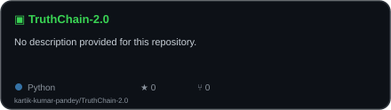
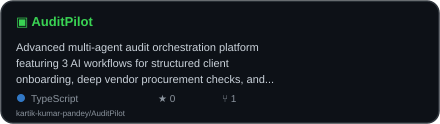
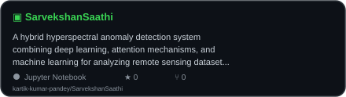
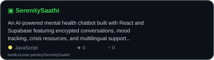
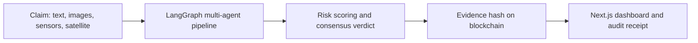
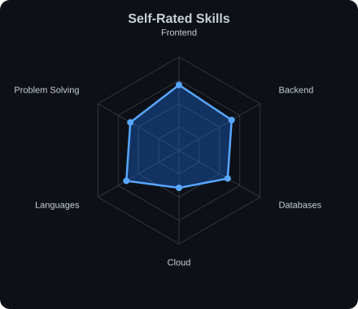
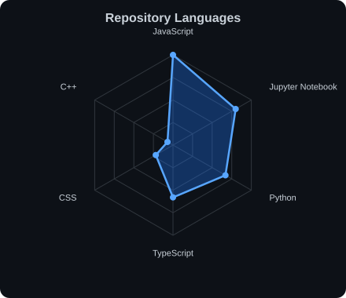

<!-- Palette: Violet #7C3AED · Cyan #22D3EE · Lavender #A78BFA · Pink accent #F472B6 · Dark #0D1117 -->

<!-- ═══════════════ HEADER (local file: assets/header.svg) ═══════════════ -->

  

  

  
  
  
  

  
  
  

---

## 👨‍💻 About Me

I build **responsive, scalable, and user-friendly applications**, with a focus on **multi-agent AI systems**, clean code, and real-world problem solving.

| | |
|---|---|
| 🔭 **Currently building** | TruthChain 2.0: multimodal AI + blockchain insurance claim engine |
| 🌱 **Currently learning** | Next.js · System Design · Cloud Technologies |
| 🧠 **Focus areas** | LangGraph agents · Computer vision · Blockchain · Full-stack web |
| 🤝 **Open to** | Internships, open-source collaboration |
| 💬 **Ask me about** | React, Node.js, MongoDB, APIs |
| ⚡ **Fun fact** | I enjoy debugging more than gaming |

---

## 🚀 Featured Projects

<table width="100%">
  <tr>
    <td width="50%" align="center" valign="top">
      <a href="https://github.com/kartik-kumar-pandey/TruthChain-2.0">
        <picture>
          <source media="(prefers-color-scheme: dark)" srcset="assets/card-TruthChain-2.0-dark.svg" />
          <source media="(prefers-color-scheme: light)" srcset="assets/card-TruthChain-2.0-light.svg" />
          
        </picture>
      </a>
       
      <b>Multimodal AI &amp; blockchain insurance consensus engine</b> 
      Fraud-proof claim evaluation for motor and agriculture insurance using 8- and 10-agent LangGraph pipelines, Sentinel-2 satellite data, and on-chain evidence records. 
      <code>Next.js</code> · <code>FastAPI</code> · <code>LangGraph</code> · <code>Hardhat</code> · <code>Prisma</code> 
      <a href="https://github.com/kartik-kumar-pandey/TruthChain-2.0">Code</a>
    </td>
    <td width="50%" align="center" valign="top">
      <a href="https://github.com/kartik-kumar-pandey/AuditPilot">
        <picture>
          <source media="(prefers-color-scheme: dark)" srcset="assets/card-AuditPilot-dark.svg" />
          <source media="(prefers-color-scheme: light)" srcset="assets/card-AuditPilot-light.svg" />
          
        </picture>
      </a>
       
      <b>Multi-agent audit orchestration platform</b> 
      Automates client onboarding, vendor procurement checks, and meeting intelligence with human-in-the-loop review and live agent trace logs. 
      <code>React</code> · <code>TypeScript</code> · <code>FastAPI</code> · <code>LangGraph</code> · <code>Neon Postgres</code> 
      <a href="https://github.com/kartik-kumar-pandey/AuditPilot">Code</a> · <a href="https://audit-pilot-lemon.vercel.app">Live</a> · <i>team project, forked from <a href="https://github.com/bhumika-mishra-26/AuditPilot">bhumika-mishra-26</a></i>
    </td>
  </tr>
  <tr>
    <td width="50%" align="center" valign="top">
      <a href="https://github.com/kartik-kumar-pandey/SarvekshanSaathi">
        <picture>
          <source media="(prefers-color-scheme: dark)" srcset="assets/card-SarvekshanSaathi-dark.svg" />
          <source media="(prefers-color-scheme: light)" srcset="assets/card-SarvekshanSaathi-light.svg" />
          
        </picture>
      </a>
       
      <b>Hyperspectral anomaly detection studio</b> 
      Hybrid deep learning + attention + ML pipeline for remote sensing data (Pavia, Indian Pines, Salinas) with an interactive anomaly-map dashboard. 
      <code>React</code> · <code>Flask</code> · <code>TensorFlow</code> / <code>PyTorch</code> · <code>scikit-learn</code> 
      <a href="https://github.com/kartik-kumar-pandey/SarvekshanSaathi">Code</a> · <i>team project</i>
    </td>
    <td width="50%" align="center" valign="top">
      <a href="https://github.com/kartik-kumar-pandey/SerenitySaathi">
        <picture>
          <source media="(prefers-color-scheme: dark)" srcset="assets/card-SerenitySaathi-dark.svg" />
          <source media="(prefers-color-scheme: light)" srcset="assets/card-SerenitySaathi-light.svg" />
          
        </picture>
      </a>
       
      <b>AI mental health companion chatbot</b> 
      Encrypted conversations, mood tracking, breathing exercises, crisis resources, and English/Hindi support, powered by Google Gemini 2.0 Flash. 
      <code>React</code> · <code>Supabase</code> · <code>Tailwind</code> · <code>Gemini</code> 
      <a href="https://github.com/kartik-kumar-pandey/SerenitySaathi">Code</a> · <a href="https://serenitysaathi.vercel.app">Live</a>
    </td>
  </tr>
</table>

<b>🔍 Project deep-dives (highlights &amp; architecture)</b>

 

### 🛡️ TruthChain 2.0
- Two insurance domains: **Motor** (8 sequential agents: text, image, telematics, cross-modal, investigation, risk, adversarial, decision) and **Agriculture** (10 agents with parallel evidence extraction).
- Satellite evidence from **Sentinel-2 (CDSE STAC)**, crop health via **DINOv2**, and weather anomaly checks via Open-Meteo.
- Final verdicts are recorded through an **EvidenceRegistry smart contract** and shown in a **Next.js** dashboard with a Leaflet map and live agent timeline.

### 🧭 AuditPilot
- LangGraph orchestrator with Intake, Strategy, Execution and Validation agents.
- **Human-in-the-loop** breakpoints, a pattern memory for recurring anomalies, and WebSocket-streamed trace logs.
- Deployed on **Vercel** (frontend) and **Render** (backend) with **Neon PostgreSQL**.

### 🛰️ SarvekshanSaathi
- Pipeline: PCA + normalization, patch extraction, reconstruction, attention scoring, classification, anomaly maps.
- Drag-and-drop `.mat` upload, light/dark themes, and an animated orbiting workflow built with GSAP and Three.js.
- Includes a research-paper write-up and experiment notebooks in the repo.

### 🌿 SerenitySaathi
- Supabase auth with Row Level Security, AES-256 message encryption, and per-user preferences.
- Mood tracker, guided breathing, resource library, and a crisis support section.
- MIT licensed and live on Vercel.

---

## ⚡ Tech Stack

<table align="center">
  <tr>
    <td align="center"><b>Frontend</b></td>
    <td></td>
  </tr>
  <tr>
    <td align="center"><b>Backend</b></td>
    <td></td>
  </tr>
  <tr>
    <td align="center"><b>AI / ML</b></td>
    <td>
      
      
      
    </td>
  </tr>
  <tr>
    <td align="center"><b>Blockchain</b></td>
    <td>
      
      
    </td>
  </tr>
  <tr>
    <td align="center"><b>Languages</b></td>
    <td></td>
  </tr>
  <tr>
    <td align="center"><b>Database &amp; Cloud</b></td>
    <td></td>
  </tr>
  <tr>
    <td align="center"><b>Tools</b></td>
    <td></td>
  </tr>
</table>

---

## 🎯 Goals

- [x] Ship full-stack AI apps with live deployments
- [x] Build multi-agent systems with LangGraph
- [ ] Master Next.js and production-grade system design
- [ ] Get hands-on with cloud deployment (AWS)
- [ ] Contribute to open-source projects

---

## 📊 GitHub Stats

  
  

  

<b>📡 More analytics (skill radar · contribution calendar)</b>

 

  <picture>
    <source media="(prefers-color-scheme: dark)" srcset="assets/radar-dark.svg" />
    <source media="(prefers-color-scheme: light)" srcset="assets/radar-light.svg" />
    
  </picture>
  <picture>
    <source media="(prefers-color-scheme: dark)" srcset="assets/radar-langs-dark.svg" />
    <source media="(prefers-color-scheme: light)" srcset="assets/radar-langs-light.svg" />
    
  </picture>

  

---

## 🐍 Contribution Snake

  <picture>
    <source media="(prefers-color-scheme: dark)" srcset="https://raw.githubusercontent.com/kartik-kumar-pandey/kartik-kumar-pandey/output/snake-dark.svg" />
    <source media="(prefers-color-scheme: light)" srcset="https://raw.githubusercontent.com/kartik-kumar-pandey/kartik-kumar-pandey/output/snake.svg" />
    
  </picture>

---

## 🧩 LeetCode

  

---

## 🤝 Let's Collaborate

I'm open to **internships**, **open-source contributions**, and **AI / full-stack project collaborations**.
If you're working on something interesting in multi-agent AI, blockchain, or web apps, reach out.

  
  

<!-- ═══════════════ FOOTER (local file: assets/footer.svg) ═══════════════ -->

  

